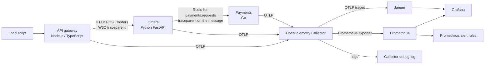

# OpenTelemetry tracing demo

A small checkout flow with three services, one HTTP call, and one Redis hop. Each service emits OpenTelemetry traces, metrics, and logs that share a trace id. An OpenTelemetry Collector forwards traces to Jaeger and metrics to Prometheus. Grafana has a provisioned dashboard and two alert rules.

This is a portfolio demo for Arpan Bom's CV. It is not a payment system. Nothing here charges a card, stores customers, or authenticates callers. Redis has no password because it only runs on the local compose network. Alert thresholds in `deploy/alerts.yml` and the Grafana rules are **placeholders**. They are not measured service level objectives, and this repo does not claim latency or throughput numbers.

## Architecture



`POST /checkout` on the gateway calls orders. Orders writes a payment message to the Redis list `payments.requests`. The message carries `traceparent` and `tracestate`, and the Go consumer extracts that context before starting `payments.process`. A failure injected at payments still returns HTTP 200 from the gateway, because the HTTP handlers finish when the message is queued. The failed span shows up on the same trace in Jaeger.

Stdout from each service is JSON with `trace_id` and `span_id`. The same span context is attached to the OpenTelemetry log record sent to the collector.

## Run

Docker Compose builds the three services and starts Redis, the collector, Jaeger, Prometheus, and Grafana.

```bash
docker compose up --build
```

| Surface | URL |
| --- | --- |
| Gateway | http://localhost:18081 |
| Orders | http://localhost:18082 |
| Payments health | http://localhost:18083/health |
| Jaeger | http://localhost:16686 |
| Prometheus | http://localhost:19090 |
| Grafana | http://localhost:13000 |

Grafana signs in as `admin` / `admin` on this local demo. Anonymous viewers can open the dashboard. The provisioned board is **Checkout tracing demo**.

Generate traffic, including injected errors and latency:

```bash
python3 scripts/load.py --url http://localhost:18081 --count 40
```

`--error-rate` and `--latency-rate` default to 0.2. Errors land on `gateway`, `orders`, or `payments`. Latency is a sleep of `--latency-ms` (default 300) on one of those stages. The script prints the trace id from each response. Search that id in Jaeger.

One checkout by hand:

```bash
curl -s http://localhost:18081/checkout \
  -H 'content-type: application/json' \
  -d '{"sku":"field-notes","amount":12,"quantity":1}'
```

Metric names on the dashboard follow the OpenTelemetry-to-Prometheus conversion of the instruments the services record (`checkout_requests`, `checkout_duration_ms`, `orders_requests`, `orders_duration_ms`, `payments_processed`, `payment_duration_ms`). No sample values are baked into the repo.

## Test

Unit tests use in-memory span exporters. They do not need Docker, Redis, or a collector.

```bash
cd gateway && npm ci && npm test
cd orders && python3 -m pip install -r requirements-dev.txt && python3 -m pytest -q
cd payments && go test ./...
python3 -m pip install -r requirements-dev.txt && python3 scripts/validate_configs.py
```

`payments` needs Go 1.26 or newer. CI uses Go 1.27.

GitHub Actions runs those three test suites, `scripts/validate_configs.py`, `otelcol-contrib validate` on `deploy/otel-collector.yaml`, and `docker compose config`.
